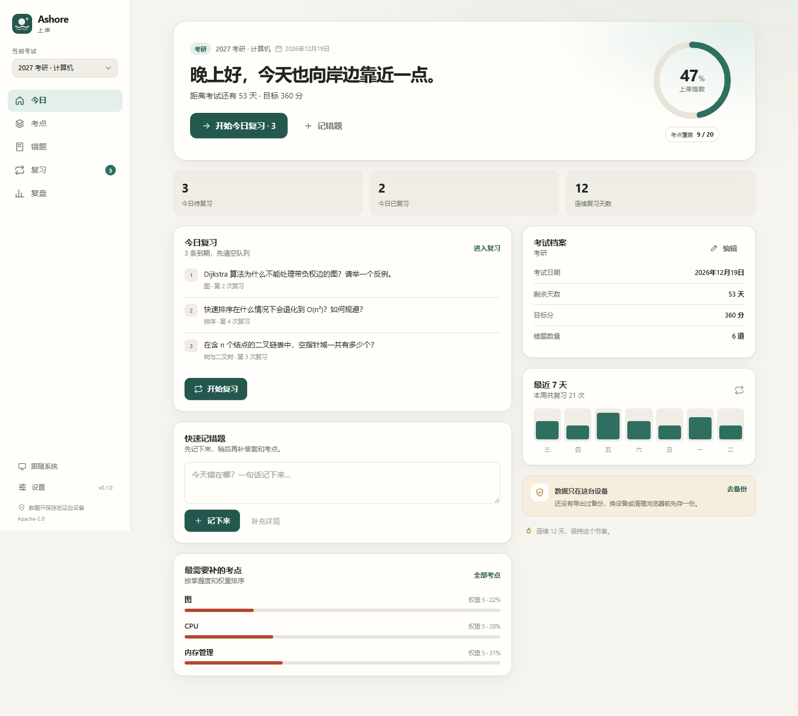
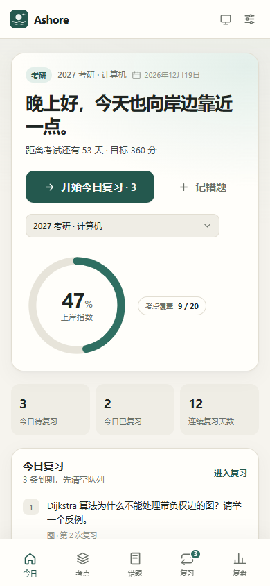
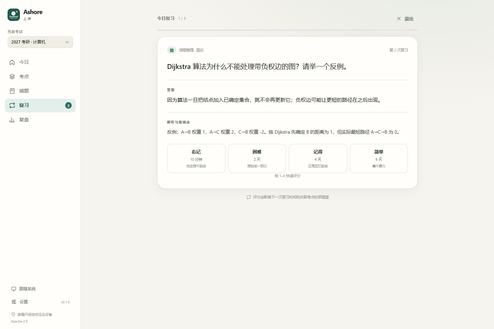

# Ashore · 上岸

**把考试大纲变成每天的任务，把错题变成上岸的进度。**

Ashore 是一个本地优先的备考工作台，面向考研、考公、四六级、高考和证书类考试。它不提供题库，而是把你的大纲、错题和复习节奏放进一个可计算的闭环：考点有 weight，错题会自动回到复习队列，掌握度会汇总成「上岸指数」。

`v0.1.0` · PWA · React 19 + TypeScript · Apache-2.0



<p align="center">
  
  
</p>

## 为什么是 Ashore

市面上的备考工具大致分三类：

- 计时类只管专注时长，不回答“我到底掌握了多少”。
- 题库类的护城河是内容，个人项目很难参与。
- 通用记忆卡片不理解考纲，也不计算离目标还有多远。

Ashore 选择做**方法层**：用户自带大纲和错题，工具负责把它们变成可执行的每日任务，并且坚持本地优先、数据可导出、代码可审计。

高考用户也可以使用自定义考试；v0.1 的产品重心放在自驱型成人考试，避免与题库平台在内容和渠道上正面竞争。

## 功能

- **上岸指数**：按考点权重汇总掌握度，实时看到 `Σ(权重 × 掌握度) / Σ(权重)`。
- **考点树**：层级、权重、掌握度、错题数；支持缩进大纲与 CSV 批量导入。
- **错题本**：题干、答案、解析、来源、标签和本地压缩图片；可关联考点、归档或删除。
- **间隔复习**：基于 SM-2 的轻量调度，四档评分，键盘 `1–4` 快速作答。
- **复盘**：12 周复习热力图、本周节奏、薄弱考点和掌握度分布。
- **本地优先**：IndexedDB 存储，无账号、无遥测；JSON 备份可导入导出。
- **双端适配**：桌面侧栏与移动端底栏共用一套代码；支持深色模式、键盘操作和 PWA 安装。

## 快速开始

要求 Node.js `>= 22.12`。

```bash
npm install
npm run dev
```

打开终端输出的地址。首次进入可以点击「载入示例数据」，也可以直接创建自己的考试。

生产构建与本地预览：

```bash
npm run build
npm run preview
```

PWA 的 Service Worker 只在生产构建中生效。用浏览器打开 `preview` 地址后，可通过浏览器菜单「安装应用 / 添加到主屏幕」安装。

## 使用流程

1. 创建考试，填写日期与目标分。
2. 录入考点，或粘贴大纲批量导入；为高频内容设置更高权重。
3. 记录错题，尽量关联到考点。
4. 每天打开「今日」，清空到期的复习队列。
5. 在「复盘」查看薄弱点，回到考点树补强。

## 导入格式

大纲文本：每行一个考点，两个空格表示下一级，行尾用 `| 数字` 设置权重（1–5）。

```text
数据结构 | 5
  线性表 | 4
  树与二叉树 | 5
    二叉树的遍历 | 5
操作系统 | 4
  进程与线程 | 5
```

也支持 Markdown 标题层级：

```text
# 数据结构 | 5
## 线性表 | 4
## 树与二叉树 | 5
```

CSV：列为 `标题, 父级, 权重`，父级留空表示顶层。

```csv
标题,父级,权重
数据结构,,5
线性表,数据结构,4
树与二叉树,数据结构,5
```

Ashore 不内置任何版权题库或大纲内容，导入的资料由使用者自行准备。

## 数据与隐私

- 所有考试、考点、错题和复习记录只保存在当前浏览器的 IndexedDB。
- 没有账号系统，没有服务端，没有遥测。
- 在支持持久化存储的浏览器上会请求持久化权限，但浏览器仍可能回收空间；定期导出才是最终保障。
- 「设置 → 数据」可以导出 JSON 备份，也可以从备份恢复。
- 浏览器清理站点数据、iOS 回收 PWA 存储等情况可能造成数据丢失，建议定期导出备份。
- 错题内容目前按纯文本渲染；图片会在浏览器内压缩后保存，不会上传。

## 技术结构

```text
src/
  core/        纯 TypeScript 领域逻辑：类型、调度、掌握度、日期、导入解析
  data/        Dexie 表结构、事务仓库、示例数据、备份恢复
  ui/          自绘设计系统：按钮、表单、对话框、提示、环形进度、图标
  features/    今日、考点、错题、复习、复盘、设置与外框
  hooks/       Dexie 实时查询、主题
  stores/      主题与当前考试偏好
  styles/      设计令牌、全局样式、页面通用布局
scripts/       图标生成、文件头检查、包体预算、截图
docs/          架构、数据模型、约定与 ADR
e2e/           Playwright 核心流程测试
```

v0.1 使用单包分层，`src/core` 不依赖 React。这样既保留了领域逻辑的可测试性，也避免在接口尚未稳定时过早拆 monorepo；拆分路径记录在 ADR 0003。桌面端计划使用 Tauri 2 套壳，详见 ADR 0001。

## 常用脚本

| 命令                    | 作用                                           |
| ----------------------- | ---------------------------------------------- |
| `npm run dev`           | 启动 Vite 开发服务器                           |
| `npm run build`         | 类型检查并构建生产包                           |
| `npm run preview`       | 预览生产构建                                   |
| `npm run test:run`      | 运行 Vitest 单元与数据层测试                   |
| `npm run test:e2e`      | 运行 Playwright 核心流程测试                   |
| `npm run check`         | 文件头、Lint、格式、类型、单测、构建与包体预算 |
| `npm run check:headers` | 单独检查源码文件头                             |
| `npm run check:bundle`  | 检查首屏与总包体预算                           |
| `npm run icons`         | 从 SVG 生成 PWA 图标                           |
| `npm run capture`       | 用系统 Edge/Chrome 截取文档截图                |
| `npm run format`        | Prettier 格式化                                |
| `npm run lint`          | ESLint 检查                                    |

`npm run check` 不包含端到端测试，因为 Playwright 需要额外的浏览器运行时；CI 会在构建后单独执行。

## 质量门槛

- 首屏 JS ≤ 180 KB gzip，全部 JS ≤ 260 KB gzip。
- 首屏 CSS ≤ 40 KB gzip，全部 CSS ≤ 60 KB gzip。
- 每个源码文件必须包含版权、许可证、文件说明、作者、邮箱和日期文件头。
- 核心调度、掌握度、日期与导入解析必须有单元测试。
- 提交信息遵循 Conventional Commits，贡献使用 DCO 签名。

## 路线图

- `v0.2`：Tauri 2 桌面壳；错题图片 OCR；打印错题卷；命令面板。
- `v0.3`：可选 WebDAV / S3 同步；多设备备份；更细的复习统计。
- 更远：移动端应用商店打包、插件式题库导入、学习计划模板。

v0.1 明确不做：内置题库、社区、账号体系、付费、AI 出题。

## 参与贡献

请先阅读 [CONTRIBUTING.md](CONTRIBUTING.md) 与 [docs/conventions.md](docs/conventions.md)。提交前运行：

```bash
npm run check
npm run test:e2e
```

安全问题请不要开公开 Issue，按 [SECURITY.md](SECURITY.md) 的方式私下报告。

## 许可证

本项目使用 [Apache License 2.0](LICENSE)，版权归 星河一叶Roxy 所有。第三方依赖的许可证以其各自声明为准。

## 维护者

星河一叶Roxy · [ck_xuv@vip.qq.com](mailto:ck_xuv@vip.qq.com)

如果 Ashore 对你的备考有帮助，欢迎把使用体验、错题格式建议或复盘指标想法写成 Issue。
